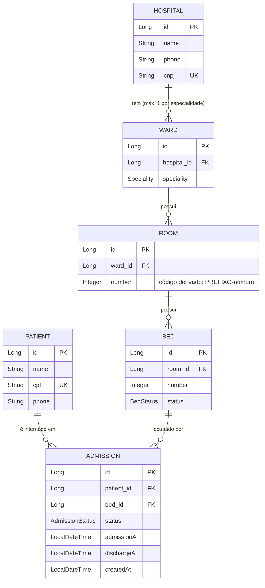

# Hospai

## Setup
```bash
docker compose up -d
sdk env # Opcional
./mvnw spring-boot:run
```
### Adminer
- http://localhost:8081/?pgsql=postgres&username=postgres&db=hospapi&ns=public&table=hospitals

### Swagger
- http://localhost:8080/api/swagger-ui/index.html

## Diagrama
