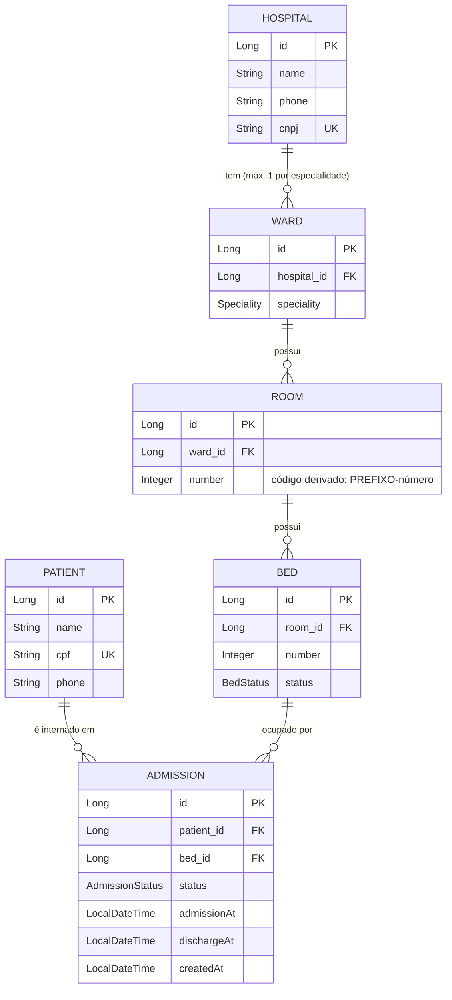

# Hospai

## Setup
```bash
docker compose up -d
sdk env # Opcional
./mvnw spring-boot:run
```
### Adminer
- http://localhost:8081/?pgsql=postgres&username=postgres&db=hospapi&ns=public&table=hospitals

### Swagger
- http://localhost:8080/api/swagger-ui/index.html

## Relatórios

Todos os paths ficam sob o context-path `/api`.

| Requisição | Endpoint |
|-|-|
| Leitos livres por especialidade | `GET /beds/available?speciality=CARDIOLOGY` (opcional: `hospitalId`) |
| Quarto em que o paciente está internado | `GET /patients/{id}/current-admission` (campo `roomCode`) |
| Todos os leitos | `GET /beds` |
| Quartos livres, ocupados e total por especialidade | `GET /rooms/occupancy` |
| Internação atual do paciente: hospital, especialidade/ala, código do quarto, paciente e data/hora de internação | `GET /patients/{id}/current-admission` |
| Histórico de internações do paciente (paginado): paciente, especialidade/ala, data de internação e de alta | `GET /patients/{id}/admissions?page=0&size=20` |
| Quartos com algum leito disponível: especialidade/ala e código do quarto | `GET /rooms/available` |
| Pacientes internados agora, por especialidade e em ordem alfabética: paciente, data de internação e dias internado | `GET /admissions/active` |
| Histórico de internações de um leito: número do leito, paciente, data de internação e de alta | `GET /beds/{id}/admissions` |

## Diagrama
